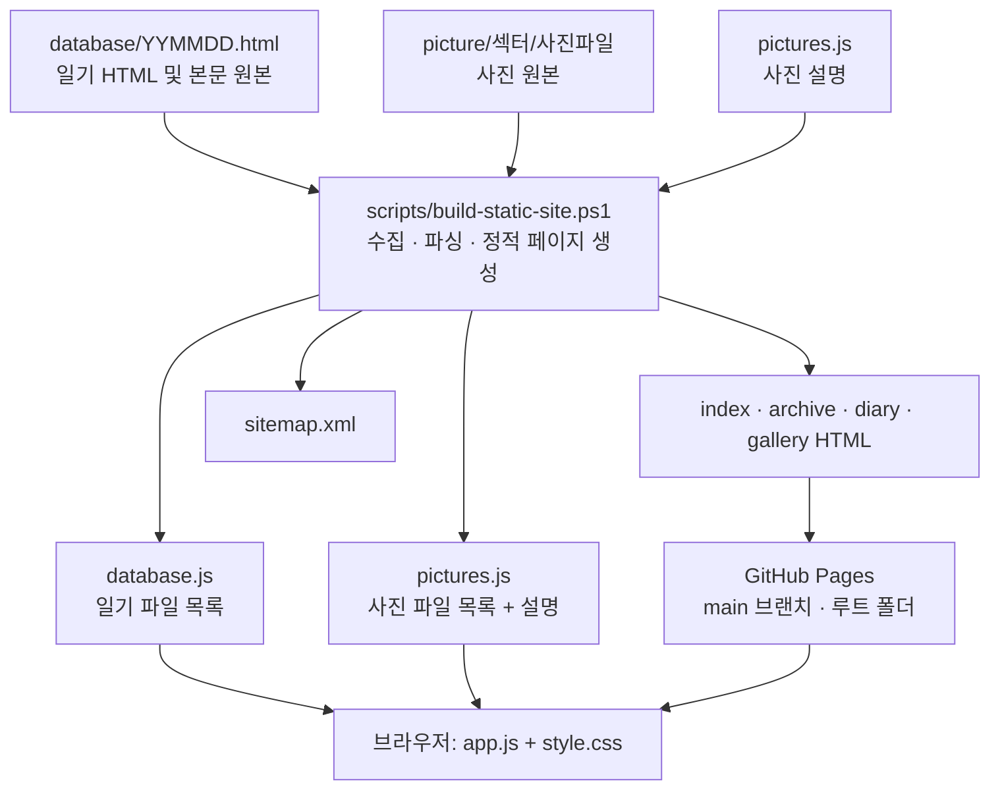

# REXONDEX Archive 설계 및 운영 안내

이 문서는 프로젝트를 수정하거나 일기를 추가할 때 참고하는 설계도입니다. 폴더의 역할, 브라우저에서 페이지가 표시되는 과정, 일기·사진 파싱 규칙, SEO 파일 생성 방식, 배포 절차를 설명합니다.

## 매번 복붙하는 스크립트 명령어

새 일기·사진을 추가하거나 수정한 뒤, **프로젝트 루트 폴더의 PowerShell**에서 아래 명령을 실행합니다.

```powershell
powershell -NoProfile -ExecutionPolicy Bypass -File ./scripts/build-static-site.ps1
```

**입력 형식·파싱 규칙·거부 조건의 기준 문서:** [정적 생성 스크립트 핵심 계약서](docs/SEO-SCRIPT-CONTRACT.md)

성공하면 `Updated snapshots and sitemap…` 메시지가 표시됩니다. 그 뒤 변경 파일을 확인하고 직접 커밋·푸시합니다. 이 명령은 Git 명령을 실행하거나 자동으로 푸시하지 않습니다.

## 한눈에 보는 구조



핵심은 **원본을 추가·수정하고, 생성 스크립트를 로컬에서 실행한 뒤, 원본과 생성 결과를 함께 직접 푸시하는 정적 사이트**라는 점입니다. 사이트 방문 중 서버나 데이터베이스에서 일기를 만드는 구조가 아닙니다.

## 새 일기나 사진을 올릴 때

위의 스크립트 명령을 실행한 다음 변경 파일을 확인하고 직접 커밋·푸시합니다.

```powershell
git status --short
git add .
git commit -m "Add diary or photos"
git push
```

스크립트는 Git 명령을 실행하지 않습니다. 별도 패키지 설치나 빌드 도구도 필요하지 않습니다. GitHub Pages는 `main` 브랜치의 루트 폴더를 배포 소스로 사용합니다. 사용자 정의 Actions 워크플로는 없지만, GitHub가 Pages 배포를 위해 관리하는 작업은 Actions 화면에 보일 수 있습니다.

## 페이지가 만들어지는 과정

1. `build-static-site.ps1`이 `database/`의 일기 파일과 `picture/` 아래 섹터 폴더·사진을 검색합니다.
2. 일기 날짜와 사진 파일 목록을 검증하고, 기존 사진 설명을 읽습니다.
3. `database.js`, `pictures.js`의 목록을 실제 파일 구성에 맞춰 다시 생성합니다.
4. 일기별 HTML 페이지와 홈·전체 일기·사진 갤러리의 초기 정적 본문을 만듭니다.
5. 각 페이지의 제목, 설명, canonical, 공유 메타 정보, 구조화 데이터, 페이지 링크를 생성합니다.
6. 모든 페이지와 검색 가능한 이미지가 포함된 `sitemap.xml`을 씁니다.
7. 모든 파싱·생성이 성공하면 임시 파일을 준비하고 출력 파일을 교체합니다.
8. 변경된 원본과 생성 결과를 GitHub에 직접 푸시하면 GitHub Pages가 정적 파일을 배포합니다.

이 과정에서 HTML 페이지, 메타 정보, 파일 목록, 사이트맵은 자동으로 다시 작성됩니다. 잘못된 입력이 발견되면 생성 파일을 쓰기 전에 중단합니다. 실제 파일 교체 단계에서 오류가 나면 기존 출력 파일을 복원하며, 복원까지 실패한 경우 복구용 백업 경로를 오류에 표시합니다.

### `build-static-site.ps1` 내부 처리 단위

| 순서 | 처리 | 입력과 결과 |
|---|---|---|
| 1. 일기 검색 | `database/` 바로 아래에서 `YYMMDD.html`을 찾고 실제 날짜인지 확인합니다. 최근 날짜부터 정렬합니다. | 일기 ID와 파일명 목록 |
| 2. 사진 검색 | 섹터 폴더별로 직접 들어 있는 지원 이미지 파일만 찾습니다. 기존 `pictures.js`는 설명을 보존하기 위해 읽습니다. | 섹터·파일 목록과 기존 설명 |
| 3. 브라우저 목록 작성 | 일기 파일 목록을 `database.js`에, 검색한 사진 목록과 보존한 설명을 `pictures.js`에 씁니다. | `database.js`, `pictures.js` |
| 4. 일기 본문 읽기 | 전체 HTML에서 `.post-content`와 `.post-references`를 추출합니다. 전체 HTML이 아닌 조각 파일은 파일 전체를 본문으로 사용합니다. | 날짜별 본문과 참고 링크 |
| 5. 본문 정규화 | `[[URL]]` 표식을 본문에서 제거해 참고 링크로 이동합니다. HTML 태그가 없는 일반 텍스트는 빈 줄·줄바꿈을 문단·`<br>`로 바꿉니다. HTML 태그와 구조는 유지하고, 첫 날짜 전용 문단만 파일명에 맞춥니다. | 화면 표시용 본문과 링크 |
| 6. 페이지 생성 | 일기별 페이지, 최근 일기 홈, 전체 일기, 섹터별 사진 페이지를 만들고 각 페이지의 메타 정보와 JSON-LD를 채웁니다. | 정적 HTML 파일 |
| 7. 사이트맵 작성 | 모든 주요 페이지 및 HEIC를 제외한 지원 이미지 주소를 모아 XML로 기록합니다. | `sitemap.xml` |

스크립트의 `Read-DiarySection`은 중첩 `<div>`를 고려해 해당 본문 영역의 닫는 태그를 찾습니다. `Extract-DiaryLinkMarkers`는 URL 링크 표식을 수집해 참고 링크 영역으로 옮기고, `Convert-PlainDiaryText`는 순수 텍스트 본문만 문단 형태로 바꿉니다. `Render-Shell`은 공통 화면 틀을 만들며 `Render-Page`는 canonical·메타 태그·JSON-LD·스크립트 참조를 포함한 HTML 문서로 저장합니다.

페이지를 만들기 전에 일기 날짜, 섹션 개수, HTML 태그 짝, 링크 표기, 사진 경로, 홈 템플릿을 검사합니다. 문서의 형식이 약속을 벗어나면 파일명과 문제가 된 항목, 수정 방법을 표시하고 중단합니다. 임시 생성물은 검사가 모두 끝난 뒤에만 교체하므로, 잘못된 일기 하나 때문에 나머지 사이트 파일이 일부만 갱신되는 일을 방지합니다.

## 일기 파일 규칙과 파싱 방식

### 파일 이름

- 위치: `database/` 바로 아래
- 이름: `YYMMDD.html` 형식의 숫자 6자리
- 날짜는 실제 달력에 존재해야 합니다. 예: `261030.html`은 2026년 10월 30일입니다.
- 해당 형식에 맞는 파일은 모두 게시 대상입니다. 초안은 `draft-261030.html`처럼 다른 이름을 사용하거나 다른 폴더에 둡니다.
- 하위 폴더 안의 일기 파일은 검색 대상이 아닙니다.

### 본문 작성 방법

처음 만들 때는 HTML 조각 또는 일반 텍스트를 파일에 작성할 수 있습니다. 생성 스크립트가 완성된 HTML 페이지 틀을 씌웁니다.

일반 텍스트 예시:

```text
[[https://www.threads.com/share/example/]]

26.10.30
피곤스르넹

다음 문단입니다.
같은 문단에서 줄을 바꾸면 줄바꿈으로 표시됩니다.
```

일반 텍스트에는 다음 규칙이 적용됩니다.

- 빈 줄은 문단 구분(`<p>`)이 됩니다.
- 문단 안의 한 줄 바꿈은 줄바꿈(`<br>`)이 됩니다.
- HTML 태그가 있는 본문은 HTML 구조를 그대로 사용합니다. HTML 작성 시 문단은 `<p>`, 문단 내부 줄바꿈은 `<br>`로 지정합니다.

HTML 예시:

```html
<p>26.10.30</p>
<p>첫째 줄<br>같은 문단의 다음 줄</p>
<p>다음 문단</p>
```

일기 본문에 사용할 수 있는 HTML 태그는 다음과 같습니다.

`a`, `abbr`, `article`, `aside`, `b`, `blockquote`, `br`, `cite`, `code`, `dd`, `del`, `div`, `dl`, `dt`, `em`, `figcaption`, `figure`, `footer`, `h1`–`h6`, `header`, `hr`, `i`, `img`, `kbd`, `li`, `mark`, `ol`, `p`, `pre`, `q`, `rp`, `rt`, `ruby`, `s`, `samp`, `section`, `small`, `span`, `strong`, `sub`, `sup`, `table`, `tbody`, `td`, `th`, `thead`, `time`, `tr`, `u`, `ul`, `var`, `wbr`.

`<a>`에는 `href`, ``에는 `src`를 지정해야 합니다. `<script>`, `<style>`, `<iframe>` 등 페이지 실행·틀을 바꿀 수 있는 요소, `onclick` 같은 이벤트 속성, 인라인 `style`, `javascript:` 주소는 거부합니다. 새 태그가 꼭 필요하다면 `scripts/build-static-site.ps1`의 `Assert-DiaryMarkup` 허용 목록에 의도와 안전성을 검토한 뒤 추가합니다.

### 스크립트가 읽는 HTML 영역

이미 생성된 일기를 다시 실행할 때 스크립트는 파일 전체를 다시 해석해 날짜와 본문을 찾습니다.

- `.post-content`: 일기의 본문
- `.post-references`: 본문 위에 보여줄 참고 링크

이 영역은 `<div class="post-content">…</div>`처럼 작성합니다. 중첩된 `<div>`도 깊이를 세어 닫는 태그를 찾습니다. 본문을 수정할 때는 `.post-content` 안의 내용만 편집하고, 그 밖의 페이지 틀·제목·메타 정보는 자동 생성 영역으로 취급합니다.

### 본문 링크 표기

본문 어느 위치에서든 `[[https://주소]]`를 쓰면 링크 표식이 본문에서 제거되고, 링크는 본문 위의 참고 링크 영역으로 옮겨집니다. 이 방식으로 생성된 링크는 기존 참고 링크와 같은 UI를 사용합니다.

```text
기록 내용
[[https://www.threads.com/share/example/]]
이어지는 기록
```

표시 문구를 별도로 정하려면 확장 표기법을 사용합니다.

```text
[[링크|https://example.com|관련 글 보기]]
```

링크 표식에는 `http://` 또는 `https://` 주소를 넣습니다. 기존 HTML `<a href="주소">표시 문구</a>`도 사용할 수 있습니다. 기존 `.post-references` 안에 작성한 HTML 링크는 그대로 보존됩니다.

### 스크립트가 일기에서 만드는 정보

- 날짜: 파일명으로부터 생성
- 페이지 제목·설명·canonical·Open Graph·Twitter 메타 정보
- `BlogPosting` JSON-LD 구조화 데이터
- 작성자·날짜·참고 링크·본문·이전/다음 일기 링크
- 홈 최근 일기 8개와 전체 일기 페이지의 초기 HTML 본문

각 일기는 `database/YYMMDD.html` 주소로 직접 열 수 있습니다. 본문은 JavaScript가 꺼져 있어도 HTML에 포함됩니다. 첫 본문 문단이 날짜만 표시하면 파일명의 날짜에 맞춰 정규화합니다.

## 사진 폴더 규칙과 파싱 방식

사진은 섹터 폴더 바로 안에 둡니다.

```text
picture/
├─ sector-1/
│  ├─ photo.jpg
│  └─ another.webp
└─ sector-2/
   └─ image.png
```

- 검색 범위는 `picture/` 바로 아래의 섹터 폴더 한 단계와 그 폴더 바로 안의 파일입니다.
- 폴더 이름은 영문·숫자·하이픈만 사용합니다. 예: `sector-2`, `travel-2026`.
- 사진을 섹터 폴더보다 더 깊은 하위 폴더에 넣으면 검색하지 않습니다.
- 지원 확장자: JPG, JPEG, PNG, WebP, GIF, AVIF, HEIC.
- `picture/` 루트에 사진을 직접 두면 위치 안내 오류를 내고 중단합니다.
- 파일명은 URL 경로로 인코딩되어 링크에 반영됩니다.
- 사진 섹터별 갤러리 HTML과 이미지 사이트맵을 생성합니다. HEIC는 방문자에게 제공하지만 Google 이미지 사이트맵에서는 제외합니다.

`pictures.js`의 `descriptions`는 선택 입력입니다. 사진 설명은 직접 편집할 수 있고, 다음 실행에서도 파일이 남아 있는 한 유지됩니다. `files` 목록은 실제 폴더를 스캔해 다시 만듭니다. 삭제·이름 변경된 사진은 목록과 갤러리에서 빠집니다.

## 주요 파일과 책임

| 파일/폴더 | 역할 | 직접 편집 여부 |
|---|---|---|
| `database/YYMMDD.html` | 일기 본문 원본이자 일기별 정적 페이지 | 본문 편집 |
| `picture/섹터/` | 사진 원본 | 파일 추가·삭제 |
| `scripts/build-static-site.ps1` | 원본 검색, 파싱, 검증, 정적 HTML·메타·사이트맵 생성 | 동작 변경 시 편집 |
| `docs/SEO-SCRIPT-CONTRACT.md` | 입력 인터페이스·생성 결과·거부·복구 규칙의 기준 설계 문서 | 기능 계약 변경 시 함께 편집 |
| `scripts/manifest.ps1` | `pictures.js` 같은 JavaScript 배열을 실행하지 않고 읽고, 목록 형식을 검증하는 공통 함수 | 보통 편집하지 않음 |
| `scripts/test-seo.ps1` | 생성된 페이지·canonical·구조화 데이터·사이트맵·로컬 링크를 빠르게 확인 | 선택적으로 실행 |
| `database.js` | 브라우저가 사용하는 일기 HTML 파일 목록 | 자동 생성, 직접 편집하지 않음 |
| `pictures.js` | 브라우저가 사용하는 섹터·사진 파일 목록과 사진 설명 | 파일 목록 자동 생성, `descriptions`는 직접 편집 가능 |
| `index.html` | 홈 피드의 SEO용 초기 HTML 및 앱 진입점 | 자동 생성 |
| `archive.html` | 전체 일기의 SEO용 초기 HTML 및 앱 진입점 | 자동 생성 |
| `pictures.html`, `pictures/*.html` | 섹터별 사진 갤러리의 SEO용 초기 HTML 및 앱 진입점 | 자동 생성 |
| `sitemap.xml` | 페이지와 이미지의 검색엔진 사이트맵 | 자동 생성 |
| `app.js` | 피드, 일기 데이터 로딩, 달력, 섹터 탐색, 사진 모달 등 브라우저 동작 | 기능 변경 시 편집 |
| `style.css`, `theme.css` | 레이아웃·컴포넌트 스타일과 테마 색상 | 디자인 변경 시 편집 |
| `theme-init.js` | 페이지 표시 초기에 저장된 테마 또는 시스템 테마 적용 | 보통 편집하지 않음 |
| `legacy-links.js` | 예전 `#daily-…` 주소를 홈으로 보내는 호환 처리 | 보통 편집하지 않음 |
| `robots.txt`, `.nojekyll` | 크롤러 안내와 GitHub Pages 정적 파일 배포 설정 | 유지 |

### 브라우저에서 표시되는 순서

1. 브라우저는 먼저 파일에 저장된 정적 HTML, 제목, 설명, canonical, JSON-LD를 읽습니다.
2. `app.js`는 `database.js` 목록을 사용해 필요한 `database/*.html` 파일을 가져옵니다.
3. 앱은 각 일기의 `.post-content`와 `.post-references`를 읽어 홈 피드·달력에 표시합니다. 참고 링크가 있으면 달력에서 표시 대상으로 구분합니다.
4. `pictures.js`의 섹터·사진 목록으로 갤러리를 구성하고, 사진을 선택하면 모달을 엽니다. 사진의 링크는 원본 이미지로 연결됩니다.
5. JavaScript가 실행되지 않아도 개별 정적 페이지의 본문과 기본 링크는 표시됩니다.

## SEO 및 정적 페이지 생성

일기마다 독립된 HTML 주소를 제공하고, 초기 HTML 자체에 제목·설명·canonical·본문·BlogPosting 데이터를 넣습니다. 내부 이동은 실제 `<a href="…">` 링크를 사용합니다. 페이지와 지원되는 이미지 주소는 `sitemap.xml`에 기록하고, `robots.txt`가 사이트맵 주소를 알려줍니다.

스크립트는 다음 정적 문서를 갱신합니다.

- `index.html`: 최근 일기 8개
- `archive.html`: 전체 일기
- `database/YYMMDD.html`: 일기별 독립 페이지
- `pictures.html` 및 `pictures/섹터.html`: 사진 섹터 갤러리
- `sitemap.xml`: 페이지 및 지원 이미지 URL

이미지 설명은 직접 작성한 경우에만 alt 텍스트로 사용합니다. 설명이 없으면 비어 있는 alt를 둡니다. HEIC 원본은 갤러리에서 열 수 있지만 Google 이미지 사이트맵 대상은 아닙니다.

이 구성은 검색엔진이 읽을 수 있는 정적 HTML을 제공하기 위한 것입니다. 검색 노출·색인·순위 자체를 보장하지는 않습니다.

## 오류가 나면 확인할 항목

- **일기 파일이 등록되지 않음:** 파일이 `database/` 바로 아래 있는지, 이름이 `YYMMDD.html`인지, 날짜가 실제로 유효한지 확인합니다.
- **본문이 비어 있거나 파싱 오류:** 전체 HTML 문서라면 `.post-content`가 있어야 합니다. 여는 `<div>`와 닫는 `</div>`가 짝을 이루는지 확인합니다.
- **허용되지 않는 HTML 오류:** 오류에 표시된 태그가 위 목록에 있는지 확인합니다. 스크립트·스타일·이벤트 속성이나 `javascript:` 주소는 제거하고, 꼭 필요한 새 태그는 허용 목록을 검토해 추가합니다.
- **섹션 오류:** 전체 HTML 문서는 `.post-content`가 정확히 하나 있어야 하며 `.post-references`는 최대 하나입니다. 본문 조각 파일에는 별도 문서 틀을 넣지 않아도 됩니다.
- **링크 표식이 글자로 남음:** 정확히 `[[https://주소]]` 형태인지 확인하고, 표식을 `.post-content` 안에 넣습니다.
- **사진이 누락됨:** 지원 확장자인지, 파일이 섹터 폴더 바로 안에 있는지, 섹터 폴더 이름이 허용 문자만 사용하는지 확인합니다.
- **스크립트 실행이 중단됨:** 오류 메시지에 표시된 파일·폴더를 먼저 수정합니다. 실행이 성공하면 `Updated snapshots and sitemap…` 메시지가 표시됩니다.
- **페이지가 배포되지 않음:** 먼저 변경된 원본과 생성 파일이 모두 커밋·푸시됐는지 확인합니다. GitHub Pages 배포 오류는 로컬 생성 스크립트 오류와 별개일 수 있습니다.

## 생성 결과 빠른 검사

배포 전 선택적으로 다음 검사를 실행할 수 있습니다.

```powershell
powershell -NoProfile -ExecutionPolicy Bypass -File ./scripts/test-seo.ps1
```

이 검사는 파일을 수정하지 않고 sitemap XML, 실제 페이지 존재 여부, canonical·구조화 데이터, 일기 목록, 이미지 경로와 로컬 링크를 확인합니다.

## GitHub Pages와 예전 링크

GitHub 저장소의 `Settings` → `Pages`에서 다음 설정을 사용합니다.

- Source: **Deploy from a branch**
- Branch: **main**
- Folder: **/(root)**

예전 `#daily-…` 형태의 주소는 개별 일기를 복원하지 않고 사이트 홈으로 이동합니다. 이는 이전 링크의 유입을 홈으로 연결하기 위한 호환 처리입니다.
